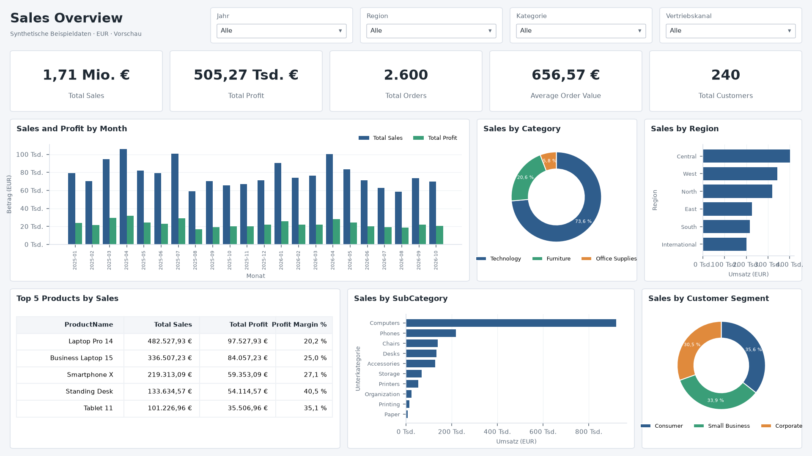

# Sales Overview – Power-BI-Projekt (.pbip)

Dieser Ordner enthält das fertige Dashboard als **Power-BI-Projekt**. Es besteht aus dem Datenmodell, den Measures und vier Berichtsseiten: **Overview** (nach `Dashboard_Layout.md`), **Product Analysis**, **Customer Analysis** und **Geography**. Power BI Desktop öffnet das Projekt direkt; beim ersten Speichern kannst du es zusätzlich als `.pbix` sichern.

Die Bilder `preview_*.png` sind mit Python nachgebaute Vorschauen mit den echten Zahlen, keine Screenshots aus Power BI.

## Öffnen (Windows-VM)

1. Den ganzen Ordner `PowerBI_Sales_Overview_Starter` nach Windows kopieren, am einfachsten nach `C:\PowerBI\SalesOverview\`. Die drei CSV-Dateien liegen dann direkt in diesem Ordner, das Projekt im Unterordner `Sales_Overview_PBIP`.
2. `Sales_Overview_PBIP\Sales_Overview.pbip` doppelklicken (oder in Power BI Desktop: **Datei > Öffnen**).
3. **Liegen die CSVs woanders?** **Start > Daten transformieren > Parameter bearbeiten** und `DataFolder` auf deinen Ordner setzen (z. B. `D:\Daten\SalesOverview\`).
4. **Start > Aktualisieren.** Danach zeigen alle Visuals Daten.
5. Optional: **Datei > Speichern unter > Sales_Overview.pbix** in einem eigenen Ausgabeordner.

Bei einer älteren Power-BI-Desktop-Version (vor 2025) unter **Datei > Optionen > Vorschaufeatures** diese Optionen aktivieren und Desktop neu starten: „Power BI Project (.pbip) save option“, „Store semantic model using TMDL format“ und „Store reports using enhanced metadata format (PBIR)“.

## Datenmodell

**Sternschema:** `Products` 1→* `Sales`, `Customers` 1→* `Sales`, `Calendar` 1→* `Sales[OrderDate]`. Die Filterrichtung ist überall einfach. `Calendar` ist eine DAX-Tabelle und als Datumstabelle markiert; `Month` wird nach `Month Number` sortiert. Die CSV-Dateien werden mit dem Gebietsschema `en-US` eingelesen, damit Dezimalpunkte auch unter einem deutschen Windows richtig erkannt werden.

**Measures (Tabelle `Sales`):**
- Total Sales, Total Profit, Total Cost
- Total Orders, Total Quantity, Total Customers
- Average Order Value, Profit Margin % (= Gewinn / Umsatz)
- Sales Previous Month, Sales MoM Change %
- **Sales per Customer** (neu, für die Kundenseite)

Beträge sind als EUR formatiert, Quoten als Prozent.

## Berichtsseiten (je 16:9, 1280 × 720)

Jede Seite hat oben einen Titel und vier Dropdown-Slicer, darunter eine Reihe KPI-Karten und zwei Reihen mit Visuals. Ein Klick in ein Diagramm filtert die Slicer nicht. Zwischen den Diagrammen und den KPI-Karten bleibt die normale Kreuzfilterung bzw. Hervorhebung aktiv.

| Seite | Slicer | KPI-Karten | Visuals |
|---|---|---|---|
| **Overview** | Jahr, Region, Kategorie, Vertriebskanal | Total Sales, Total Profit, Total Orders, Average Order Value, Total Customers | Umsatz und Gewinn pro Monat (Säulen, chronologisch) · Umsatz nach Kategorie (Ring) · Umsatz nach Region (Balken) · Top 5 Produkte (Tabelle, Top-N-Filter) · Umsatz nach Unterkategorie (Balken) · Umsatz nach Kundensegment (Ring) |
| **Product Analysis** | Jahr, Kategorie, Region, Vertriebskanal | Total Sales, Total Profit, Profit Margin %, Total Quantity | Umsatz und Gewinn nach Unterkategorie (Balken) · Gewinnmarge nach Kategorie (Säulen) · Umsatz vs. Gewinnmarge je Produkt (Punktdiagramm) · Produkttabelle mit allen 18 Produkten · Monatsumsatz je Kategorie (Linien) |
| **Customer Analysis** | Jahr, Region, Kundensegment, Vertriebskanal | Total Sales, Total Customers, Total Orders, Average Order Value, Sales per Customer | Umsatz und Gewinn nach Segment (Säulen) · Umsatz nach Segment und Kanal (Säulen) · Aktive Kunden pro Monat (Linie) · Top 10 Kunden (Tabelle, Top-N-Filter) · Kunden nach Segment (Ring) |
| **Geography** | Jahr, Kategorie, Kundensegment, Vertriebskanal | Total Sales, Total Profit, Profit Margin %, Total Customers | Umsatz und Gewinn nach Region (Balken) · Umsatz nach Stadt (Balken) · Umsatz nach Land (Ring) · Regionstabelle mit Land/Region/Stadt · Monatsumsatz je Region (Linien) |

## Kontrollwerte (ohne Filter)

| Prüfpunkt | Erwartet |
|---|---|
| Total Sales / Total Profit | 1.707.090,78 € / 505.273,78 € |
| Total Orders / Total Customers / Total Quantity | 2.600 / 240 / 4.365 |
| Average Order Value / Sales per Customer | 656,57 € / 7.112,88 € |
| Profit Margin % gesamt | 29,6 % |
| Umsatz 2025 / 2026 | 945.725,77 € / 761.365,01 € |
| Kategorie Technology / Furniture / Office Supplies | 1.256.383,91 € / 351.265,98 € / 99.440,89 € |
| Gewinnmarge Office Supplies / Furniture / Technology | 43,1 % / 40,0 % / 25,6 % |
| Top-5-Produkte (absteigend) | Laptop Pro 14 482.527,93 € · Business Laptop 15 336.507,23 € · Smartphone X 219.313,09 € · Standing Desk 133.634,57 € · Tablet 11 101.226,96 € |
| Top-Kunde | C0070 Robin Bauer, 20.719,31 € |
| Kunden je Segment | Consumer 87 · Small Business 82 · Corporate 71 |
| Aktive Kunden pro Monat | zwischen 78 und 105 |
| Region höchste / niedrigste | Central (Frankfurt) 400.455,50 € / International (Vienna) 200.615,41 € |
| Land Germany / Austria | 1.506.475,37 € / 200.615,41 € |
| Monatsachse | 2025-01 … 2026-10 (22 Monate; Oktober 2026 nur bis zum 23.10.) |

## Hinweise zu den Daten

- **Kundennamen sind nicht eindeutig:** 156 Namen für 240 Kunden. Die Top-10-Tabelle zeigt deshalb die `CustomerID` mit und filtert über die ID. Sonst würden Kunden mit gleichem Namen zusammengezählt.
- **Region und Stadt:** Jede Region hat genau eine Stadt (z. B. Central = Frankfurt). „International“ ist Wien (Österreich). Die Diagramme „nach Region“ und „nach Stadt“ zeigen deshalb dieselben Werte mit anderen Beschriftungen.
- **Karte:** Ein Kartenvisual ist bewusst nicht enthalten, weil `Dashboard_Layout.md` es nur als Option nennt. Kartenvisuals sind in manchen Power-BI-Umgebungen außerdem deaktiviert. Bei Bedarf kann eine Karte mit `Customers[City]` und `Customers[Country]` ergänzt werden.

## Bekannte Grenzen

- Das Projekt wurde auf einem Mac erzeugt und **nicht in Power BI Desktop geöffnet**. Geprüft wurde zweierlei: Alle 68 Berichtsdateien sind gegen die offiziellen Microsoft-JSON-Schemas gültig, und das Datenmodell wird von Microsofts TMDL-Bibliothek fehlerfrei geladen (4 Tabellen, 3 Beziehungen, 11 Measures). Ob die Visuals in Power BI genau wie in den Vorschauen aussehen, ist damit noch nicht geprüft.
- Die KPI-Karten für Umsatz und Gewinn kürzen automatisch ab (z. B. „1,71 Mio. €“). Den vollen Betrag zeigt die Tooltip-Anzeige; alternativ unter **Format > Beschriftungen > Anzeigeeinheiten** „Keine“ wählen.
